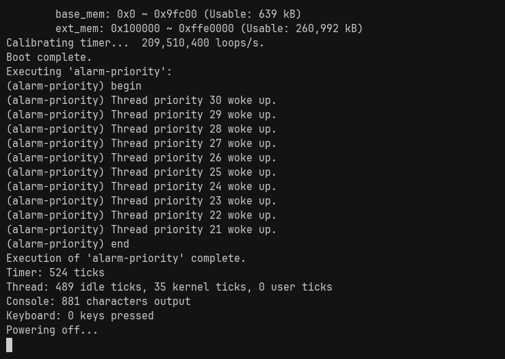

# 🐧 lrn-pintos — 스레드 스케줄링과 가상 메모리를 구현한 교육용 커널

KAIST PintOS x86-64 골격 위에 **우선순위 스케줄링·priority donation·MLFQS·시스템 콜·demand paging·Copy-on-Write fork**를 직접 구현한 커널입니다. "스레드가 어떤 순서로 실행되고, 프로세스가 메모리를 어떻게 나눠 쓰고 되돌려주는가"를 코드로 확인하려고 만들었습니다.



## 버전업된 모습

팀 과제가 끝난 시점에 두 가지가 남아 있었습니다. 하나는 **아예 구현되지 않은 MLFQS**, 다른 하나는 **테스트는 통과하는데 실제로는 틀린 선점 코드**였습니다.

MLFQS는 `thread_set_nice`·`thread_get_load_avg`·`thread_get_recent_cpu`가 전부 `/* TODO */` 스텁으로 `0`을 반환하는 상태였습니다.[^stub] 이걸 4BSD 규칙대로 구현하면서 제일 까다로웠던 건 **정수 연산으로는 `recent_cpu` 감쇠 계수를 표현할 수 없다**는 점이었습니다. `(2*load_avg)/(2*load_avg+1)` 같은 값이 정수 나눗셈에서는 0이나 1로 뭉개집니다. 결국 17.14 고정소수점 연산을 따로 만들어 그 위에 올렸습니다. 갱신 대상도 ready 큐가 아니라 **blocked 스레드를 포함한 전체 스레드**여야 했습니다 — 자고 있는 스레드의 `recent_cpu`도 감쇠해야 깨어났을 때 우선순위가 맞기 때문입니다. 그래서 `all_elem`으로 전역 스레드 목록을 따로 유지하게 됐습니다. 마지막으로 MLFQS와 priority donation을 **동시에 켜면 안 된다**는 것(donation이 MLFQS가 계산한 우선순위를 덮어씁니다)을 뒤늦게 알고 `synch.c`에서 `thread_mlfqs`일 때 donation 경로를 통째로 우회하도록 고쳤습니다.

두 번째가 더 뼈아팠습니다. `thread_create()`에서 새 스레드에게 CPU를 양보할지 판단할 때 **호출자가 넘긴 `priority` 인자를 비교하고 있었고, 실제로 스레드에 설정된 `t->priority`를 봐야 했습니다.** 기본 스케줄러에서는 두 값이 같아 증상이 없었지만, MLFQS에서는 생성 직후 우선순위가 다시 계산되므로 엉뚱한 스레드가 CPU를 잡습니다. `priority` → `t->priority`, 한 글자짜리 차이인데 그때까지 통과하던 테스트는 아무것도 잡아주지 못했습니다.

고친 뒤 vm 141개 회귀를 다시 돌려 깨진 것이 없는지 확인했고, 로컬에서만 재현되는 걸 막으려고 x86 QEMU CI를 붙였습니다.

| 항목 | 팀 과제 종료 시점 | 현재 |
|---|---|---|
| MLFQS (`nice`·`recent_cpu`·`load_avg`) | **미구현** — `/* TODO */` 스텁이 `0` 반환[^stub] | **4BSD 규칙 구현**, 17.14 고정소수점 |
| MLFQS 갱신 대상 | — | **전체 스레드(`all_elem`, blocked 포함)** |
| MLFQS + priority donation | — | **MLFQS일 때 donation 경로 우회** |
| `thread_create` 선점 판단 | 인자 `priority` 비교 (MLFQS에서 오동작) | **`t->priority` 비교** |
| 회귀 검증 | 로컬 수동 | **x86 QEMU GitHub Actions (threads·vm job 분리)** |

## 구동모습

QEMU에서 커널을 부팅하고 우선순위 스케줄링 테스트(`alarm-priority`)를 실행하는 모습입니다. 10개 스레드가 **우선순위 30 → 21 순서대로** 깨어나는 것이 스케줄러가 의도대로 도는 증거입니다.


## 메인 기술

- **우선순위 스케줄링과 priority donation** — 높은 우선순위부터 실행하고, lock 대기 시 소유자에게 우선순위를 넘겨 priority inversion을 막습니다. 중첩 donation과 다중 lock 보유를 처리합니다. → [`threads/thread.c`](pintos/threads/thread.c), [`threads/synch.c`](pintos/threads/synch.c)
- **4BSD MLFQS (17.14 고정소수점)** — `nice`·`recent_cpu`·`load_avg`로 우선순위를 주기적으로 재계산합니다. 1초마다 `load_avg`와 전체 스레드의 `recent_cpu`를, 4틱마다 우선순위를 갱신합니다. → [`threads/thread.c`](pintos/threads/thread.c)
- **Copy-on-Write fork** — fork 시 프레임을 읽기 전용으로 공유하다 쓰기 page fault에서 복사합니다. 참조가 하나만 남으면 복사 없이 쓰기 권한만 돌려줍니다. → [`vm/vm.c`](pintos/vm/vm.c)
- **참조 수 기반 프레임 교체** — 프레임마다 `ref_count`와 `owner_thread`를 추적하고, **참조 수가 1인 프레임만 교체 대상으로 선택**합니다. swap-out 시 소유자의 `pml4`에서 해당 페이지를 함께 내려 stale mapping을 남기지 않습니다. → [`include/vm/vm.h`](pintos/include/vm/vm.h), [`vm/vm.c`](pintos/vm/vm.c), swap 연산은 [`vm/anon.c`](pintos/vm/anon.c)
- **Demand paging · mmap · stack growth** — 접근 시점에 페이지를 채우고, 파일 backed 페이지와 스택 확장을 page fault 경로에서 구분합니다. → [`vm/file.c`](pintos/vm/file.c), [`vm/vm.c`](pintos/vm/vm.c)
- **프로세스 수명 관리** — fork·exec·wait, 부모·자식 종료 순서, **부모가 먼저 죽은 자식(orphan)의 상태 회수**를 두 개의 세마포어로 처리합니다. → [`userprog/process.c`](pintos/userprog/process.c), [설계 노트](docs/pintos/10-orphan-reaping.md)

## 계획

- userprog 스위트를 CI에 추가해 threads·vm과 함께 회귀로 묶는다.
- swap 경로를 **공유 중인 프레임까지** 교체 대상으로 넓힌다. 현재는 참조 수 1인 프레임만 고른다.
- 파일 시스템 과제(buffer cache, extensible file, subdirectory)를 이어서 구현한다.
- 메모리 압박·스케줄링 조합을 무작위로 섞는 스트레스 테스트를 만들어 QEMU 통과가 못 잡는 구간을 찾는다.

## 링크

- [PintOS Wiki](https://docs.woonyong.com/wiki/pintos/) — 단계별 개념 정리
- [단계별 구현 기록](docs/pintos/)
- [부모 종료 후 자식 상태 회수 설계](docs/pintos/10-orphan-reaping.md)
- [팀 원본 저장소 (Jungle-12-303/wk11_7)](https://github.com/Jungle-12-303/wk11_7)
- [KAIST PintOS 과제 안내](https://casys-kaist.github.io/pintos-kaist/)
- [CI 실행 기록](https://github.com/woonyong-choi/lrn-pintos/actions)

## 담당

**크래프톤 정글 팀 과제(원본: [Jungle-12-303/wk11_7](https://github.com/Jungle-12-303/wk11_7))에서 시작했고, 종료 후 개인 저장소에서 계속 수정·학습·확장하고 있습니다.**

| 항목 | 내용 |
|---|---|
| 원본 팀 저장소 | [Jungle-12-303/wk11_7](https://github.com/Jungle-12-303/wk11_7) |
| 팀 과제 기간 | 2026-04-23 ~ 2026-05-21 (커밋 `581a1e4` ~ `5c8f52c`) |
| 팀 구성 | 7인. `main` 에 병합된 기여자는 6인이고, 나머지 1인의 커밋은 병합되지 않은 브랜치에 남아 있다 — `git shortlog -sne --all` 로 확인 |
| **본인 담당** | **팀 기간 커밋 159/214개(약 74%, `main` 기준)로 최다 기여. threads(alarm·priority·donation)와 userprog·vm 전반.** MLFQS는 팀 기간에 미구현으로 남아 종료 후 개인 작업으로 구현했다 |

기반 커널·테스트 하니스는 KAIST 과제 제공물입니다. 팀 코드 전체를 개인 구현으로 주장하지 않으며, 팀 구현과 개인 변경은 커밋 저자와 파일별 diff로 구분합니다.

### 개인 확장 (팀 과제 종료 후)

**커밋 범위: [`e10cec5`](https://github.com/woonyong-choi/lrn-pintos/commit/e10cec5) (2026-08-02) ~ [`d8a194d`](https://github.com/woonyong-choi/lrn-pintos/commit/d8a194d) (2026-09-11), 9개 커밋.** `git log --author` 기준입니다.[^authors]

| 무엇이 달라졌나 | 커밋 | 파일 |
|---|---|---|
| **MLFQS 구현**(팀 종료 시점에는 TODO 스텁) — 4BSD 규칙, 17.14 고정소수점, 전체 스레드 갱신용 `all_elem` 목록, MLFQS일 때 donation 우회 | [`09df7c8`](https://github.com/woonyong-choi/lrn-pintos/commit/09df7c8) | `thread.c` (+188), `thread.h` (+3), `synch.c` (+9) |
| **선점 판단 버그 수정** — `thread_create`에서 요청값 대신 실제 `t->priority` 비교. vm 141개 회귀 재검증 | [`ea154f8`](https://github.com/woonyong-choi/lrn-pintos/commit/ea154f8) | `thread.c` |
| **x86 QEMU CI 도입** — threads·vm job 분리, ubuntu-22.04 + `qemu-system-x86` | [`d84c249`](https://github.com/woonyong-choi/lrn-pintos/commit/d84c249) | `.github/workflows/ci.yml` |
| 저장소 정리 — 중복 문서 제거, 커널 범위 명확화, 출처·기여 경계 명시 | [`e10cec5`](https://github.com/woonyong-choi/lrn-pintos/commit/e10cec5), [`23e6157`](https://github.com/woonyong-choi/lrn-pintos/commit/23e6157), [`d8a194d`](https://github.com/woonyong-choi/lrn-pintos/commit/d8a194d) | `docs/`, `README.md` |
| 검증된 기여 수치 정정 | [`5594d46`](https://github.com/woonyong-choi/lrn-pintos/commit/5594d46) | `README.md` |

팀 과제 종료 시점(`5c8f52c`) 대비 커널 코드 순증은 `pintos/` 기준 +188/-14행입니다(`git diff --stat 5c8f52c HEAD -- pintos/`).

## 구동방법

x86-64 Linux, GCC, Make, Perl, QEMU가 필요합니다. **macOS(arm64)에서는 저장소의 x86-64 Dev Container를 씁니다.**

```bash
git clone https://github.com/woonyong-choi/lrn-pintos.git
cd lrn-pintos
```

컨테이너 안(또는 x86-64 Linux)의 Bash에서 저장소 루트에서 실행합니다.

```bash
source pintos/activate
make -C pintos/threads check     # 스레드 스케줄링
make -C pintos/vm check          # 가상 메모리
```

Docker만 있다면 Dev Container를 직접 띄워도 됩니다.

```bash
docker build --platform linux/amd64 -t pintos-dev .devcontainer/
docker run --rm --platform linux/amd64 -v "$PWD:/w" -w /w pintos-dev \
  bash -lc 'source pintos/activate && make -C pintos/threads check'
```

`activate`는 저장소의 `pintos/utils`를 PATH에 추가합니다. 각 명령은 커널을 빌드하고 QEMU에서 검사를 실행하며, 개별 실행 출력과 판정은 해당 디렉터리의 `build/tests/`에 남습니다. 단계별 구현 기록은 [`docs/pintos/`](docs/pintos/)를 참조합니다.

## 스펙

| 구분 | 내용 |
|---|---|
| 언어 | C (GNU C, 커널 모드 freestanding) + x86-64 어셈블리 |
| 대상 아키텍처 | x86-64 |
| 골격 | [KAIST PintOS](https://casys-kaist.github.io/pintos-kaist/) (과제 제공물) |
| 빌드 | GNU Make, GCC, Perl (테스트 하니스) |
| 실행·검증 | QEMU (`qemu-system-x86`) |
| 개발 환경 | Dev Container — Ubuntu 22.04 linux/amd64 |
| CI | GitHub Actions `ubuntu-22.04`, threads·vm job 분리 |

## 검증

[](https://github.com/woonyong-choi/lrn-pintos/actions/workflows/ci.yml)

**threads 27개, vm 141개 — 총 168개 전부 통과**합니다.

| 스위트 | 통과 | 명령 |
|---|---:|---|
| threads | **27/27** | `make -C pintos/threads check` |
| vm | **141/141** | `make -C pintos/vm check` |
| **합계** | **168/168** | |

두 스위트 모두 **2026-09-22 로컬 Docker(linux/amd64)에서 직접 재실행**해 확인했습니다.[^run] 같은 트리(`d8a194d`)의 GitHub Actions 실행 기록도 같은 수치입니다.[^ci]

```bash
source pintos/activate
make -C pintos/threads check     # All 27 tests passed.
make -C pintos/vm check          # All 141 tests passed.
```

### 현재 범위와 한계

교육용 커널로서 범용 OS의 장치 드라이버·보안·다중 코어 지원을 목표로 하지 않습니다. **QEMU 검사 통과가 모든 메모리 압박·스케줄링 조합의 정확성을 보장하지 않습니다** — 실제로 위의 선점 버그는 141개 테스트를 통과하는 동안 남아 있었습니다. swap은 참조 수가 1인 프레임만 고르므로 공유 중인 프레임까지 자유롭게 교체하는 구현은 아닙니다. 파일 시스템 과제(buffer cache, extensible file, subdirectory)는 범위 밖입니다.

팀 원본과 비교할 때는 저장소 이름뿐 아니라 커밋을 함께 확인합니다.

## 참고자료

- [KAIST PintOS 과제 안내](https://casys-kaist.github.io/pintos-kaist/) — 골격 코드와 테스트 하니스 출처
- [단계별 구현 기록](docs/pintos/) · [부모 종료 후 회수 설계](docs/pintos/10-orphan-reaping.md)
- [팀 원본 저장소 Jungle-12-303/wk11_7](https://github.com/Jungle-12-303/wk11_7)
- Operating System Concepts (Silberschatz) — MLFQS·priority inversion
- [커널 라이선스](pintos/LICENSE)

[^authors]: `git log --author='woonyong' --since=2026-06-01 --reverse --format='%h %ad %s' --date=short`
[^stub]: `git show 09df7c8^:pintos/threads/thread.c` 의 `thread_set_nice`·`thread_get_nice`·`thread_get_load_avg`·`thread_get_recent_cpu`.
[^run]: `docker run --rm --platform linux/amd64 -v "$PWD:/w" -w /w <devcontainer image> bash -lc "source pintos/activate && make -C pintos/threads check && make -C pintos/vm check"` → `All 27 tests passed.` / `All 141 tests passed.`
[^ci]: [GitHub Actions run 34506766057](https://github.com/woonyong-choi/lrn-pintos/actions/runs/34506766057) (2026-09-10, commit `d8a194d`).
