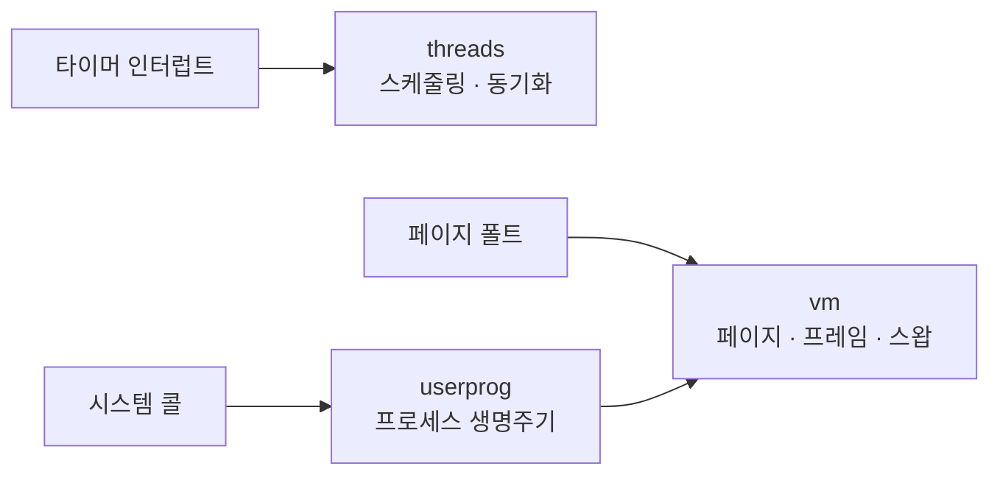

# PintOS — 스레드 스케줄링과 가상 메모리 학습

KAIST PintOS x86-64 골격에 스레드 스케줄링, 사용자 프로세스, 가상 메모리를 구현한 팀 학습 프로젝트입니다.

- 팀 기간에는 alarm·priority donation과 userprog·vm 전반을 맡았습니다. 팀원은 파일 시스템 콜, 프레임 테이블, 교체 알고리즘, mmap 본체를 담당했습니다.
- 과제 종료 후 MLFQS와 Copy-on-Write fork를 구현하고, 전체 테스트로 드러나지 않던 선점 오류 두 건을 재현 테스트부터 추가해 수정했습니다.
- CI의 x86 QEMU 환경에서 threads 28/28, userprog 96/96, vm 142/142를 확인했습니다. 팀/개인 변경의 커밋 단위 경계는 [담당 범위 문서](docs/contribution.md)에 기록했습니다.

## 데모

QEMU에서 실제로 `make check`를 실행한 화면입니다(threads 테스트 6개, 2배속 재생). `alarm-single`·`alarm-priority`·`priority-change`·`priority-donate-one`·`priority-donate-nest`·`priority-sema`가 모두 통과해 "All 6 tests passed."가 출력됩니다. `pass` 줄이 두 번 나오는 것은 테스트 실행 중 한 번, `make check` 요약에서 한 번 출력되기 때문입니다. Apple Silicon에서 Docker(linux/amd64 에뮬레이션)로 돌렸고, 재현 명령은 아래 "빠르게 실행하기" 4번입니다.


## 빠르게 실행하기

x86-64 Linux, GCC, Make, Perl, QEMU가 필요합니다. macOS(arm64)에서는 저장소의 x86-64 Dev Container를 씁니다. 아래 명령은 2026-09-23에 같은 저장소 상태에서 실행해 통과를 확인했습니다.

```bash
git clone https://github.com/woonyong-choi/lrn-pintos.git && cd lrn-pintos
docker build --platform linux/amd64 -t pintos-dev .devcontainer/
docker run --rm --platform linux/amd64 -v "$PWD:/w" -w /w pintos-dev \
  bash -lc 'source pintos/activate && make -C pintos/userprog check'   # All 96 tests passed.
docker build --load -t pintos-demo -f scripts/Dockerfile.demo scripts && bash scripts/demo_check.sh   # All 6 tests passed.
```

threads·vm 전체 스위트는 CI가 실행합니다(아래 "검증" 절). `activate`는 저장소의 `pintos/utils`를 PATH에 추가하고, 각 명령은 커널을 빌드한 뒤 QEMU에서 검사를 실행합니다. 개별 실행 출력은 해당 디렉터리의 `build/tests/`에 남습니다.

## 구조

```
lrn-pintos/
├── pintos/
│   ├── threads/      # 스케줄링 · 동기화 · MLFQS
│   ├── userprog/     # 시스템 콜 · 프로세스 생명주기
│   ├── vm/           # 페이지 · 프레임 · 스왑 · Copy-on-Write
│   ├── filesys/      # 파일 시스템(과제 제공, 미확장)
│   └── tests/        # 스위트별 회귀 테스트
├── docs/          # 설계 노트 · 단계별 구현 기록 · 담당 범위
├── scripts/       # 데모 실행 스크립트(Docker + QEMU)
└── .github/workflows/ci.yml   # threads · userprog · vm CI
```



세 진입점(타이머 인터럽트·시스템 콜·페이지 폴트)이 각각 threads·userprog·vm으로 들어가고, userprog는 프로세스가 페이지를 요구하는 지점에서 vm과 다시 연결됩니다. 전체 설계 근거는 [설계 노트](docs/design.md)와 [단계별 구현 기록](docs/pintos/)에 있습니다.

## 구현에서 확인한 점

- **우선순위 큐** — `ready_list`를 정렬 상태로 유지하고, 우선순위가 바뀌면 값 변경과 큐 재배치를 `thread_set_effective_priority()`로 묶었습니다. MLFQS 선점과 ready 상태 lock holder의 priority donation에서 각각 드러난 결함은 재현 테스트([`priority-donate-ready.c`](pintos/tests/threads/priority-donate-ready.c))로 고쳤습니다. → [`threads/thread.c`](pintos/threads/thread.c), [`threads/synch.c`](pintos/threads/synch.c)
- **MLFQS 계산** — FPU 없이 `recent_cpu` 감쇠 계수를 계산하기 위해 17.14 고정소수점을 쓰고, 곱셈·나눗셈은 `int64`로 올립니다. blocked 스레드도 `all_elem`에서 함께 갱신해야 다시 깨어났을 때 우선순위가 맞습니다. → [`threads/thread.c`](pintos/threads/thread.c)
- **프레임 교체** — accessed bit를 확인하는 clock 방식으로 최근 접근한 프레임에 한 번 더 기회를 줍니다. 공유 중인 Copy-on-Write 프레임은 역매핑이 없어 교체 후보에서 제외합니다. → [`vm/vm.c`](pintos/vm/vm.c)
- **Copy-on-Write fork** — fork 직후에는 부모·자식이 읽기 전용 프레임을 공유하고, 쓰기 fault에서만 복사합니다. 원래 쓰기 권한과 현재 페이지 테이블 권한을 분리해 복구할 fault를 판단합니다. → [`vm/vm.c`](pintos/vm/vm.c)

## 검증

[](https://github.com/woonyong-choi/lrn-pintos/actions/workflows/ci.yml)

| 스위트 | 검증 대상 | 통과/전체 | 실행 명령 |
|---|---|---:|---|
| threads | 스케줄링 · 동기화 · MLFQS · priority donation | **28/28** | `make -C pintos/threads check` |
| userprog | 시스템 콜 · fork/exec/wait · 프로세스 생명주기 | **96/96** | `make -C pintos/userprog check` |
| vm | 페이지 · 프레임 · 스왑 · Copy-on-Write(threads·userprog·filesys 사전조건 포함) | **142/142** | `make -C pintos/vm check` |

수치는 CI(GitHub Actions, `ubuntu-22.04` + `qemu-system-x86`, 2026-09-22 실행, run [`35789337785`](https://github.com/woonyong-choi/lrn-pintos/actions/runs/35789337785))의 개별 job 로그에서 직접 확인한 값입니다. 세 스위트 모두 `FAIL` 0건. userprog는 96/96이며(기존에 적었던 95/95는 이번 재측정에서 정정), vm은 threads·filesys 테스트를 함께 실행하므로 세 수치를 단순 합산하지 않습니다.

## 범위와 한계

교육용 커널로서 범용 OS의 장치 드라이버·보안·다중 코어 지원을 목표로 하지 않습니다. **QEMU 검사 통과가 모든 메모리 압박·스케줄링 조합의 정확성을 보장하지 않습니다** — 위의 두 선점 버그도 전체 스위트를 통과하는 동안 남아 있었습니다. 공유 중인 프레임은 스왑아웃하지 못합니다(역매핑 구조가 없는 한계, [설계 노트 §3](docs/design.md)). swap 슬롯 고갈 경로는 실패 반환은 있으나 그 상태에서 커널이 어떻게 보이는지 테스트로 확인한 적이 없습니다. 성능은 측정한 적이 없고, `ready_list` 비용 표는 복잡도 분석일 뿐 계측값이 아닙니다([설계 노트 §5](docs/design.md)). 파일 시스템 과제(buffer cache, extensible file, subdirectory)는 범위 밖입니다.

## 관련 링크

- [설계 노트](docs/design.md) — 왜 이 자료구조인지, 버린 대안, 알려진 한계
- [단계별 구현 기록](docs/pintos/)
- [담당 범위와 개인 확장 커밋](docs/contribution.md)
- [부모 종료 후 자식 상태 회수 설계](docs/pintos/10-orphan-reaping.md)
- [PintOS Wiki](https://docs.woonyong.com/wiki/pintos/) — 단계별 개념 정리
- [팀 원본 저장소 (Jungle-12-303/wk11_7)](https://github.com/Jungle-12-303/wk11_7)
- [KAIST PintOS 과제 안내](https://casys-kaist.github.io/pintos-kaist/) — 골격 코드와 테스트 하니스 출처
- [CI 실행 기록](https://github.com/woonyong-choi/lrn-pintos/actions)
